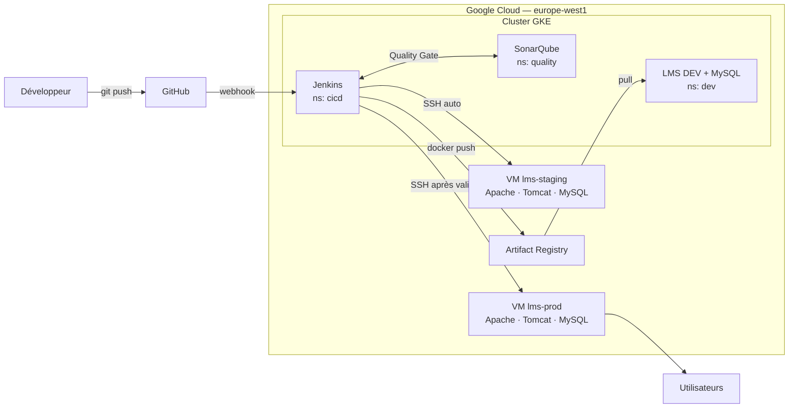

# LMS Platform — DevOps sur Google Cloud

Projet d'équipe : construire de A à Z la chaîne de livraison d'une application Java
(portail de formation en ligne) avec une architecture hybride **GKE + VM** sur Google Cloud.

Un `git push` sur `develop` déclenche automatiquement : compilation → tests → analyse
SonarQube → image Docker → déploiement DEV (GKE) → déploiement STAGING (VM).
La production est déployée après validation manuelle depuis `main`.

## Nouveau dans l'équipe ? Par où commencer

1. [`CONTRIBUTING.md`](CONTRIBUTING.md) : installer les outils, accéder à GCP, première Pull Request
2. [`docs/PLAN-EQUIPE.md`](docs/PLAN-EQUIPE.md) : les 4 rôles, qui fait quoi, dans quel ordre
3. [`CONVENTIONS.md`](CONVENTIONS.md) : les noms et valeurs à utiliser partout
4. [`docs/ADAPTATIONS.md`](docs/ADAPTATIONS.md) : les pièges de l'énoncé déjà identifiés

## Architecture



| Zone | Hébergement | Contenu | Réseau |
|---|---|---|---|
| CI/CD | GKE `cicd` | Jenkins | subnet-gke 10.0.0.0/20 |
| Qualité | GKE `quality` | SonarQube | subnet-gke |
| DEV | GKE `dev` | LMS + MySQL 8 | subnet-gke |
| STAGING | VM `lms-staging` | Apache + Tomcat 11 + MySQL 8 | subnet-staging 10.1.1.0/24 |
| PROD | VM `lms-prod` | Apache + Tomcat 11 + MySQL 8 | subnet-prod 10.1.2.0/24 |

## Stack

| Composant | Version |
|---|---|
| Java | 21 LTS |
| Jakarta EE | 10 (Servlet 6.0) |
| Tomcat | 11 |
| MySQL | 8.0 |
| Maven | 3.9 |
| OS des VM | Rocky Linux 9 |

> Le code fourni utilise une base H2 embarquée. Il doit être adapté pour MySQL
> (rôle C, branche `feature/app-mysql-support`). Les écarts entre l'énoncé et le code
> sont listés dans [`docs/ADAPTATIONS.md`](docs/ADAPTATIONS.md). Le fonctionnement de
> l'application (API, rôles, bundles) est décrit dans [`docs/application.md`](docs/application.md).

## Équipe

| Rôle | Responsable | Périmètre |
|---|---|---|
| A — Plateforme, réseau & documentation | _à compléter_ | VPC, firewall, NAT, GKE, Artifact Registry, IaC, monitoring + responsable documentation |
| B — CI : Jenkins & qualité | _à compléter_ | Jenkins, SonarQube, Jenkinsfile, webhook |
| C — Application & conteneur | _à compléter_ | Migration MySQL, Dockerfile, environnement DEV |
| D — VM STAGING & PROD | _à compléter_ | VM, Tomcat, Apache, MySQL, scripts de déploiement et rollback |

## Structure du dépôt

```
.
├── src/                  # Code source Java
├── pom.xml               # Build Maven
├── Dockerfile            # Build multi-stage (Maven → Tomcat)
├── Jenkinsfile           # Pipeline CI/CD
├── k8s/
│   ├── namespaces.yaml
│   ├── jenkins/          # Deployment, Service, PVC
│   ├── sonarqube/        # Deployment, Service, PVC
│   └── dev/              # LMS + MySQL, ConfigMap, Ingress
├── infra/                # Scripts gcloud : réseau, GKE, VM
├── scripts/              # deploy-staging.sh, deploy-prod.sh, rollback.sh
├── docs/                 # Plan d'équipe, architecture, décisions, runbooks, rapport
├── CONTRIBUTING.md       # Démarrage d'un nouveau membre, workflow Git
└── CONVENTIONS.md        # Noms et valeurs communes à toute l'équipe
```

## Documentation

Chacun documente sa brique (README de son dossier + runbook), **A** tient l'ensemble et le rapport final.

| Document | Contenu |
|---|---|
| [`docs/architecture.md`](docs/architecture.md) | Schéma et flux réseau |
| [`docs/decisions.md`](docs/decisions.md) | Journal des décisions techniques |
| [`docs/runbooks/`](docs/runbooks/) | Créer, vérifier, dépanner chaque brique + journal des difficultés |
| [`docs/rapport/rapport.md`](docs/rapport/rapport.md) | Rapport de synthèse (squelette, qui rédige quoi) |
| [`docs/ADAPTATIONS.md`](docs/ADAPTATIONS.md) | Écarts entre l'énoncé et le code |

## Workflow Git

```
feature/<rôle>-<sujet>  ──PR──▶  develop  ──PR──▶  main
                                    │                │
                              DEV + STAGING     PROD (validation)
```

1. Partir de `develop` à jour : `git checkout develop && git pull`
2. Créer sa branche : `git checkout -b feature/infra-vpc`
3. Pousser : `git push -u origin feature/infra-vpc`
4. Ouvrir une Pull Request vers `develop`, relue par un autre membre
5. Ne jamais pousser directement sur `main` ni sur `develop`

Une tâche = une Issue GitHub, suivie dans le tableau du projet.

## Démarrage

Prérequis : Git, Google Cloud CLI (`gcloud`, `kubectl`, `gke-gcloud-auth-plugin`),
Docker, Java 21 et Maven pour le build local.

```bash
git clone https://github.com/Elwa-pro/lms-platform.git
cd lms-platform
git checkout develop

gcloud auth login
gcloud config set project formation-equipe
gcloud config set compute/region europe-west1
gcloud config set compute/zone europe-west1-b
gcloud container clusters get-credentials lms-cluster --zone=europe-west1-b
kubectl get pods -A
```

Build local :

```bash
mvn clean package
docker build -t lms-platform:local .
```

## Pipeline

| # | Stage | Où | Déclencheur |
|---|---|---|---|
| 1 | Checkout | Jenkins | Push sur `develop` |
| 2 | Compile | Pod Maven | Auto |
| 3 | Test | Pod Maven | Auto |
| 4 | SonarQube + Quality Gate | Pod Maven | Auto (bloquant) |
| 5 | Package | Pod Maven | Auto |
| 6 | Docker build + push | Pod Docker | Auto |
| 7 | Deploy DEV | kubectl | Auto |
| 8 | Deploy STAGING | SSH → VM | Auto (`develop`) |
| 9 | Deploy PROD | SSH → VM | Manuel (`main`) |

## Rollback

- **DEV (GKE)** : `kubectl -n dev rollout undo deployment/lms-app`
- **STAGING / PROD (VM)** : `scripts/rollback.sh <host>` restaure le WAR précédent

## Règles de l'équipe

- **Aucun secret dans Git** : mots de passe, clés SSH et tokens vont dans Jenkins
  ou dans un Secret Kubernetes.
- **Coûts** : le cluster est redimensionné à 0 node et les VM sont arrêtées
  quand personne ne travaille.
- **Noms** : toutes les valeurs partagées sont dans [`CONVENTIONS.md`](CONVENTIONS.md).

## Avancement

L'énoncé prévoit 4 jours ; ici les 4 étapes servent d'ordre de travail, sans date imposée.

- [x] Dépôt Git structuré, plan d'équipe, conventions
- [ ] Phase 1 · Socle — Réseau, cluster GKE, Artifact Registry, VM, migration MySQL
- [ ] Phase 2 · Intégration continue — Jenkins, SonarQube, DEV sur GKE, Dockerfile, pipeline CI
- [ ] Phase 3 · Livraison — Déploiement STAGING/PROD, Quality Gate, rollback, monitoring
- [ ] Phase 4 · Sécurité & doc — Sécurisation, documentation, démonstration
