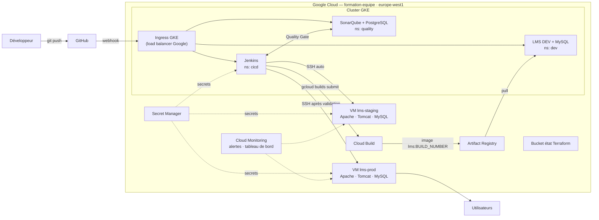

# LMS Platform — DevOps sur Google Cloud

Projet d'équipe : construire de A à Z la chaîne de livraison d'une application Java
(portail de formation en ligne) avec une architecture hybride **GKE + VM** sur Google Cloud,
décrite en **Terraform**.

Un `git push` sur `develop` déclenche automatiquement : compilation → tests → analyse
SonarQube → image construite par Cloud Build → scan Trivy → déploiement DEV (GKE) →
déploiement STAGING (VM). La production est déployée depuis `main`, après validation
manuelle dans Jenkins.

## Nouveau dans l'équipe ? Par où commencer

1. [`CONTRIBUTING.md`](CONTRIBUTING.md) : installer les outils, accéder à GCP, première Pull Request
2. [`docs/PLAN-EQUIPE.md`](docs/PLAN-EQUIPE.md) : qui fait quoi, dans quel ordre
3. [`CONVENTIONS.md`](CONVENTIONS.md) : les noms et valeurs à utiliser partout
4. [`docs/ADAPTATIONS.md`](docs/ADAPTATIONS.md) : les pièges de l'énoncé déjà identifiés
5. [`docs/decisions.md`](docs/decisions.md) : les choix techniques déjà faits, et pourquoi

## Architecture



| Zone | Hébergement | Contenu | Réseau |
|---|---|---|---|
| CI/CD | GKE `cicd` | Jenkins (configuré par fichier) | subnet-gke 10.0.0.0/20 |
| Qualité | GKE `quality` | SonarQube + PostgreSQL | subnet-gke |
| DEV | GKE `dev` | LMS + MySQL 8 | subnet-gke |
| STAGING | VM `lms-staging` | Apache + Tomcat 11 + MySQL 8 | subnet-staging 10.1.1.0/24 |
| PROD | VM `lms-prod` | Apache + Tomcat 11 + MySQL 8 | subnet-prod 10.1.2.0/24 |

### Entrées et sorties réseau

| Flux | Port | Géré par | Détail |
|---|---|---|---|
| Internet → VM | 80 → 301, 443 | Firewall GCP (P1) | Apache en HTTPS devant Tomcat |
| Internet → VM | 8443 | Firewall GCP (P1) | HTTPS alternatif si 443 est occupé. **Ouvert seulement si un service écoute réellement dessus** |
| Admin → VM | 22 | Firewall GCP (P1) | Uniquement via le tunnel IAP (`35.235.240.0/20`) |
| Internet → GKE | 443 | Ingress GKE (P2) | URLs `nip.io` vers Jenkins, SonarQube, LMS DEV |
| Namespace ↔ namespace | — | NetworkPolicy (P2) | Ex. : `dev` ne peut pas joindre Jenkins |
| Nodes GKE → Internet | 443 | Cloud NAT (P1) | Téléchargement des images, sans IP publique sur les nodes |

## Stack

| Composant | Choix |
|---|---|
| Langage / serveur | Java 21 LTS, Jakarta EE 10, Tomcat 11 |
| Base de données | MySQL 8.0 |
| Build | Maven 3.9 |
| Infrastructure as Code | Terraform (état dans un bucket GCS) |
| Conteneurs | GKE Standard, Ingress GKE, NetworkPolicy (Dataplane V2) |
| Construction d'image | Cloud Build |
| Registre | Artifact Registry |
| CI/CD | Jenkins (configuration as code) |
| Qualité / sécurité | SonarQube, Trivy |
| Secrets | Secret Manager, Secrets Kubernetes, credentials Jenkins |
| VM | Rocky Linux 9 |
| Supervision | Cloud Monitoring, ops-agent |

> Le code fourni utilise une base H2 embarquée. **P3 l'adapte pour MySQL** (branche
> `feature/app-mysql-support`). Les écarts entre l'énoncé et le code sont listés dans
> [`docs/ADAPTATIONS.md`](docs/ADAPTATIONS.md). Le fonctionnement de l'application
> (API, rôles, bundles) est décrit dans [`docs/application.md`](docs/application.md).

## Équipe

| Rôle | Responsable | Construit | Démo |
|---|---|---|---|
| **P1 — Chef de projet & infrastructure** | Asma | Terraform : réseau (VPC, 3 sous-réseaux, NAT, pare-feu), cluster GKE et nodes, Artifact Registry, Secret Manager, les 2 VM, monitoring, bucket d'état | `terraform plan` propre, infra recréée de zéro |
| **P2 — Plateforme Kubernetes** | Jules | Namespaces, Ingress GKE, NetworkPolicy, secrets du cluster, Jenkins (config par fichier + RBAC), SonarQube + PostgreSQL | `kubectl get pods -A`, pod supprimé qui revient, DEV qui ne joint pas Jenkins |
| **P3 — Pipeline & qualité** | Lamia | **Migration MySQL du code**, `Jenkinsfile`, `Dockerfile`, pod agent (maven, gcloud, trivy), job Jenkins, webhook, Quality Gate, scan Trivy | Push en direct, étapes qui s'enchaînent, Quality Gate |
| **P4 — VM, déploiement & surveillance** | Wahid | Installation des VM (`bootstrap.sh` : Java, Tomcat, Apache, **MySQL**, user `deploy`, ops-agent), scripts de déploiement et de rollback, job `lms-rollback`, appli DEV (`k8s/dev/` avec MySQL), alertes et tableau de bord | `ls /opt/tomcat/releases`, rollback, tableau de bord, email d'alerte |

### Responsabilités transverses

| Responsabilité | Titulaire | Remplaçant / règle |
|---|---|---|
| Droits IAM | P1 | P2 (personne ne doit être bloqué par une absence) |
| Relecture des Pull Requests | Binômes P1↔P4, P2↔P3 | P1 relit en plus tout ce qui touche l'infra et la PROD |
| Validation de la mise en PROD (Jenkins) | P1 | P3 (`input submitter: 'p1,p3'`) |
| Documentation | Chacun : README de son dossier + runbook | P1 assemble le rapport et anime la soutenance |

Chaque rôle a un **livrable de preuve** : 3 corrections SonarQube + tests + rapport Trivy (P3),
3 tests de rollback (automatique, manuel, Kubernetes) + une vraie alerte email avec captures (P4).

## Structure du dépôt

```
.
├── src/                       # Code source Java                        (P3)
├── pom.xml                    # Build Maven                             (P3)
├── Dockerfile                 # Build multi-stage (Maven → Tomcat)      (P3)
├── Jenkinsfile                # Pipeline CI/CD                          (P3)
├── infra/
│   ├── 00-bootstrap.sh        # Bucket d'état Terraform, APIs           (P1)
│   ├── terraform/             # Réseau, GKE, registry, secrets, VM      (P1)
│   │   └── monitoring.tf      # Alertes et tableau de bord              (P1 + P4)
│   └── vm/                    # bootstrap.sh des VM                     (P4)
├── k8s/
│   ├── namespaces.yaml        #                                         (P2)
│   ├── ingress/               # Ingress GKE, URLs nip.io                (P2)
│   ├── network-policies/      # Qui parle à qui                         (P2)
│   ├── jenkins/               # Jenkins + RBAC                          (P2)
│   │   └── agent-pod*.yaml    # Pod agent du pipeline                   (P3)
│   ├── sonarqube/             # SonarQube + PostgreSQL                  (P2)
│   └── dev/                   # LMS + MySQL en DEV                      (P4)
├── scripts/
│   ├── k8s-bootstrap.sh       # Installation de la plateforme K8s       (P2)
│   ├── sonar-setup.sh         # Projet, token, Quality Gate             (P2)
│   ├── deploy*.sh             # Déploiement sur les VM                  (P4)
│   ├── rollback.sh            # Retour arrière sur les VM               (P4)
│   └── remote/                # Scripts exécutés sur les VM             (P4)
├── docs/                      # Plan, architecture, décisions, runbooks, rapport (chacun, P1 assemble)
├── CONTRIBUTING.md
└── CONVENTIONS.md
```

## Pipeline

| # | Stage | Où | Déclencheur |
|---|---|---|---|
| 1 | Checkout | Agent Jenkins | Push sur `develop` (webhook) |
| 2 | Compile | Conteneur maven | Auto |
| 3 | Test | Conteneur maven | Auto |
| 4 | SonarQube + Quality Gate | Conteneur maven | Auto (bloquant) |
| 5 | Package (`lms.war`) | Conteneur maven | Auto |
| 6 | Build image | Cloud Build (`gcloud builds submit`) | Auto |
| 7 | Scan Trivy | Conteneur trivy | Auto (bloquant sur CRITICAL) |
| 8 | Deploy DEV | `kubectl set image` | Auto |
| 9 | Deploy STAGING + smoke tests | SSH → VM | Auto (`develop`) |
| 10 | Deploy PROD | SSH → VM | Merge sur `main` + validation P1 ou P3 |

Un second job, **`lms-rollback`**, permet de revenir à une version précédente sur STAGING ou PROD.

## Rollback

| Environnement | Méthode |
|---|---|
| DEV (GKE) | `kubectl -n dev rollout undo deployment/lms-app` |
| STAGING / PROD (VM) | Chaque version est gardée dans `/opt/tomcat/releases/`. Job `lms-rollback` ou `scripts/rollback.sh <hôte>` |
| Automatique | Le déploiement revient seul à la version précédente si le health check échoue |

## Démarrage

Prérequis : Git, Google Cloud CLI (`gcloud`, `kubectl`, `gke-gcloud-auth-plugin`),
Terraform (P1), Docker, Java 21 et Maven pour le build local.

```bash
git clone https://github.com/Elwa-pro/lms-platform.git
cd lms-platform
git checkout develop

gcloud auth login
gcloud config set project formation-equipe
gcloud config set compute/region europe-west1
gcloud config set compute/zone europe-west1-b
gcloud container clusters get-credentials lms-cluster --zone=europe-west1-b
kubectl get pods -A
```

Infrastructure (P1) :

```bash
./infra/00-bootstrap.sh          # une seule fois : bucket d'état + APIs
cd infra/terraform
terraform init
terraform plan
terraform apply
```

Build local :

```bash
mvn clean package
docker build -t lms-platform:local .
```

## Documentation

| Document | Contenu |
|---|---|
| [`docs/architecture.md`](docs/architecture.md) | Schéma et flux réseau |
| [`docs/decisions.md`](docs/decisions.md) | Journal des décisions techniques |
| [`docs/runbooks/`](docs/runbooks/) | Créer, vérifier, dépanner chaque brique + journal des difficultés |
| [`docs/rapport/rapport.md`](docs/rapport/rapport.md) | Rapport de synthèse (squelette, qui rédige quoi) |
| [`docs/ADAPTATIONS.md`](docs/ADAPTATIONS.md) | Écarts entre l'énoncé et le code |

## Workflow Git

```
feature/<rôle>-<sujet>  ──PR──▶  develop  ──PR──▶  main
                                    │                │
                              DEV + STAGING     PROD (validation)
```

1. Partir de `develop` à jour : `git checkout develop && git pull`
2. Créer sa branche : `git checkout -b feature/infra-vpc`
3. Pousser : `git push -u origin feature/infra-vpc`
4. Ouvrir une Pull Request vers `develop`, relue par son binôme
5. Ne jamais pousser directement sur `main` ni sur `develop`

Une tâche = une Issue GitHub, suivie dans le tableau du projet.

## Règles de l'équipe

- **Aucun secret dans Git** : mots de passe, clés et tokens vont dans Secret Manager,
  un Secret Kubernetes ou les credentials Jenkins. Pas de clé JSON de compte de service :
  Workload Identity pour Jenkins, compte de service attaché pour les VM.
- **Moindre privilège** : chacun reçoit les droits IAM de sa brique, pas plus. Une demande de droit = une Issue.
- **Coûts** : le cluster est redimensionné à 0 node et les VM sont arrêtées quand personne ne travaille.
- **Noms** : toutes les valeurs partagées sont dans [`CONVENTIONS.md`](CONVENTIONS.md).

## Avancement

L'énoncé prévoit 4 jours ; ici ils servent d'ordre de travail, sans date imposée.

- [x] Dépôt Git structuré, plan d'équipe, conventions
- [ ] Jour 1 · Infrastructure — Terraform, réseau, GKE, registry, Secret Manager, VM ; migration MySQL en local
- [ ] Jour 2 · Plateforme et CI — Ingress, NetworkPolicy, Jenkins, SonarQube, pipeline jusqu'au DEV
- [ ] Jour 3 · Livraison — STAGING/PROD, Quality Gate, Trivy, rollback, alertes
- [ ] Jour 4 · Rapport et soutenance — sécurité, documentation, démo
