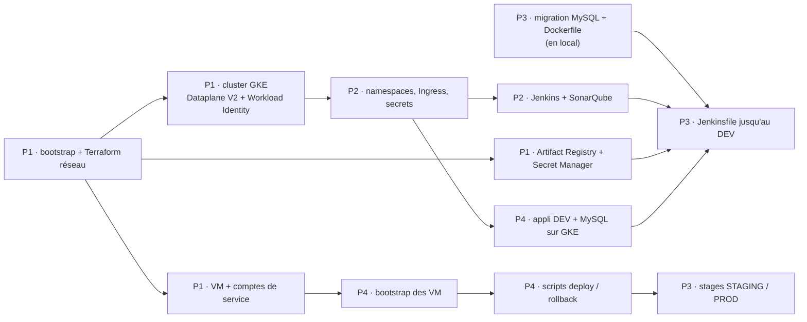

# Plan d'équipe — qui fait quoi

Chaque membre porte **une brique de bout en bout** et la présente à la soutenance.
À lire aussi : [`CONTRIBUTING.md`](../CONTRIBUTING.md) pour démarrer, [`../CONVENTIONS.md`](../CONVENTIONS.md) pour les noms,
[`ADAPTATIONS.md`](ADAPTATIONS.md) pour les pièges de l'énoncé, [`decisions.md`](decisions.md) pour les choix déjà faits.

## Vue d'ensemble

| Rôle | Responsable | Construit | Dossiers | Relu par |
|---|---|---|---|---|
| **P1 — Chef de projet & infrastructure** | Asma | Terraform : réseau (VPC, 3 sous-réseaux, NAT, pare-feu), cluster GKE et nodes, Artifact Registry, Secret Manager, 2 VM, comptes de service et IAM, monitoring (avec P4), bucket d'état | `infra/00-bootstrap.sh`, `infra/terraform/`, `README.md`, `docs/` | P4 |
| **P2 — Plateforme Kubernetes** | Jules | Namespaces, Ingress GKE (URLs `nip.io`), NetworkPolicy, secrets du cluster, Jenkins (config par fichier + RBAC), SonarQube + PostgreSQL | `k8s/` (sauf `k8s/dev/` et `agent-pod*.yaml`), `scripts/k8s-bootstrap.sh`, `scripts/sonar-setup.sh` | P3 |
| **P3 — Pipeline & qualité** | Lamia | **Migration MySQL du code**, `Dockerfile`, `Jenkinsfile`, pod agent, job `lms-pipeline`, webhook, Quality Gate, scan Trivy | `src/`, `pom.xml`, `Dockerfile`, `Jenkinsfile`, `k8s/jenkins/agent-pod*.yaml` | P2 |
| **P4 — VM, déploiement & surveillance** | Wahid | Installation des VM (Java, Tomcat, Apache, **MySQL**, user `deploy`, ops-agent), scripts de déploiement et de rollback, job `lms-rollback`, appli DEV avec MySQL, alertes et tableau de bord (avec P1) | `infra/vm/`, `scripts/deploy*.sh`, `scripts/rollback.sh`, `scripts/remote/`, `k8s/dev/`, `infra/terraform/monitoring.tf` (avec P1) | P1 |

Les binômes de relecture (P1↔P4 : Asma ↔ Wahid, P2↔P3 : Jules ↔ Lamia) travaillent sur des sujets voisins : chacun comprend ce qu'il relit.

## Responsabilités transverses

| Responsabilité | Titulaire | Remplaçant / règle |
|---|---|---|
| Droits IAM | P1 (Asma) | P2 (Jules). Une demande de droit = une Issue |
| Relecture des Pull Requests | Le binôme | P1 relit en plus tout ce qui touche l'infra, l'IAM et la PROD |
| Validation de la mise en PROD (Jenkins) | P1 (Asma) | P3 (Lamia) (`input submitter: 'p1,p3'` avec les identifiants Jenkins réels) |
| Coûts (extinction le soir) | P1 | Le dernier qui part |
| Rapport et soutenance | Chacun sa section + son runbook | P1 assemble, harmonise et anime |

## Documentation : qui écrit quoi

La documentation vit dans le repo (« docs as code ») : celui qui construit une brique la documente.

| Qui | Écrit | Où |
|---|---|---|
| Chaque responsable | README de ses dossiers | `infra/…`, `k8s/…`, `scripts/` |
| Chaque responsable | Runbook de sa brique (créer, vérifier, dépanner, supprimer) | `docs/runbooks/p<N>-*.md` |
| Chaque responsable | Journal des difficultés, **au fil de l'eau** | Fin de son runbook |
| Chaque responsable | Captures de sa démo, sa section du rapport | `docs/rapport/` |
| P1 | Schéma d'architecture, journal des décisions, assemblage du rapport | `docs/architecture.md`, `docs/decisions.md`, `docs/rapport/rapport.md` |

**Règle :** une Pull Request qui change le fonctionnement d'une brique n'est pas mergée si sa doc n'est pas à jour.

## Dépendances



**Ce qui démarre sans attendre :** P3 (migration MySQL et Dockerfile en local), P2 et P4 (écriture des manifests et du `bootstrap.sh`).
**Ce qui bloque tout le monde :** le Terraform de P1 (réseau, cluster, VM). C'est la priorité du jour 1.

## Phases

L'énoncé découpe le projet en 4 jours. Ici, pas de date imposée : ces 4 jours servent d'ordre de travail.

| Jour | P1 — Infrastructure | P2 — Kubernetes | P3 — Pipeline | P4 — VM & déploiement |
|---|---|---|---|---|
| **1 · Infrastructure** | Bootstrap, Terraform complet, IAM | Manifests en local | Migration MySQL, Dockerfile (local) | `bootstrap.sh`, vérification des VM |
| **2 · Plateforme & CI** | Droits Cloud Build / Workload Identity, relectures | Ingress, Jenkins, SonarQube, NetworkPolicy | Pod agent, Jenkinsfile jusqu'au DEV, webhook | Appli DEV sur GKE, WAR à la main sur STAGING |
| **3 · Livraison** | `monitoring.tf` avec P4 | Durcissement RBAC | Stages STAGING/PROD, Quality Gate, Trivy, corrections Sonar | Scripts deploy/rollback, job `lms-rollback`, alertes, 3 tests de rollback |
| **4 · Rapport & soutenance** | Assemblage du rapport, coûts, démo | Règles de sortie (egress) | Rapport Trivy, tests | Captures, alerte email réelle |

---

## P1 — Chef de projet & infrastructure · Asma

**Mission :** une infrastructure entièrement décrite en Terraform, recréable de zéro, et une équipe qui n'est jamais bloquée par un droit manquant.

**Tâches**
- [ ] J1 — `infra/00-bootstrap.sh` : activer les APIs, créer le bucket d'état Terraform (versionné)
- [ ] J1 — Terraform réseau : VPC, 3 sous-réseaux (plages secondaires `pods` / `services`), pare-feu (web, SSH via IAP, interne, 8443 optionnel), Cloud Router + NAT
- [ ] J1 — Terraform GKE : cluster Standard zonal, 2 × `e2-standard-2`, **Dataplane V2** (pour les NetworkPolicy), **Workload Identity**, compte de service dédié aux nodes
- [ ] J1 — Terraform : Artifact Registry `lms-docker`, IP statique de l'Ingress, secrets Secret Manager (**sans valeur** : les valeurs s'ajoutent en ligne de commande)
- [ ] J1 — Terraform : 2 VM Rocky Linux 9 avec leur compte de service (`secretAccessor`, écriture logs et métriques)
- [ ] J1 — IAM : droits de chaque membre selon sa brique ; compte de service Jenkins (Cloud Build, Artifact Registry, Secret Manager) lié par Workload Identity
- [ ] J1 — Reporter les sorties Terraform (IP, noms) dans `CONVENTIONS.md`
- [ ] J3 — `monitoring.tf` avec P4 : uptime checks, alertes, canal email, tableau de bord
- [ ] J4 — Coûts réels, assemblage du rapport, déroulé de la soutenance, `terraform destroy` final

**Comment, en bref**
```bash
./infra/00-bootstrap.sh
cd infra/terraform && terraform init && terraform plan && terraform apply
echo -n "motdepasse" | gcloud secrets versions add lms-mysql-password-staging --data-file=-
gcloud container clusters resize lms-cluster --num-nodes=0 --zone=europe-west1-b --quiet   # le soir
```
- Une valeur de secret écrite dans un fichier `.tf` finit en clair dans l'état Terraform : ne jamais le faire.

**Démo :** l'architecture, `terraform plan` qui ne trouve aucun écart, l'infrastructure recréée de zéro.
**Terminé quand :** `terraform apply` sur un projet vide recrée tout, chaque membre a ses droits et fait `get-credentials`.

---

## P2 — Plateforme Kubernetes · Jules

**Mission :** un cluster organisé, sécurisé et outillé (Jenkins, SonarQube) installable en une commande.

**Tâches**
- [ ] J1 — Écrire les manifests : namespaces, Jenkins (PVC, Deployment, Service, config par fichier, compte de service + RBAC), SonarQube + PostgreSQL (PVC), Ingress
- [ ] J2 — `scripts/k8s-bootstrap.sh` : namespaces, secrets du cluster lus depuis Secret Manager, Jenkins, SonarQube, Ingress
- [ ] J2 — Ingress GKE sur l'IP statique de P1, URLs `nip.io` (`jenkins.<IP>.nip.io`, `sonar.<IP>.nip.io`, `lms-dev.<IP>.nip.io`)
- [ ] J2 — Workload Identity : compte Kubernetes `cicd/jenkins` relié au compte de service Google `lms-jenkins`
- [ ] J2 — RBAC : Jenkins peut créer ses pods agents dans `cicd` et mettre à jour `lms-app` dans `dev`, rien d'autre
- [ ] J2 — `scripts/sonar-setup.sh` : projet `lms-platform`, token, Quality Gate
- [ ] J3 — NetworkPolicy : refus par défaut dans chaque namespace, autorisations explicites (Ingress, Jenkins → SonarQube…), `dev` ne joint pas `cicd`
- [ ] J4 — En amélioration : règles de sortie (egress)

**Comment, en bref**
```bash
./scripts/k8s-bootstrap.sh
kubectl get pods -A
kubectl -n cicd delete pod -l app=jenkins          # il revient tout seul
kubectl -n dev run test --rm -it --image=busybox --restart=Never -- wget -T 3 -qO- http://jenkins.cicd:8080   # doit échouer
```
- L'Ingress GKE vérifie la santé de chaque service : Jenkins répond sur `/login`, pas sur `/`. Prévoir une `BackendConfig` si besoin.
- Les NetworkPolicy doivent laisser passer les sondes du load balancer Google (`35.191.0.0/16`, `130.211.0.0/22`).

**Démo :** `kubectl get pods -A`, un pod supprimé qui revient, la preuve que DEV ne joint pas Jenkins.
**Terminé quand :** Jenkins et SonarQube sont accessibles par leur URL, et `k8s-bootstrap.sh` réinstalle tout sur un cluster vide.

---

## P3 — Pipeline & qualité · Lamia

**Mission :** l'application tourne sur MySQL, et un `git push` sur `develop` la livre jusqu'à STAGING sans intervention.

**Tâches**
- [ ] J1 — Branche `feature/app-mysql-support` : driver MySQL dans `pom.xml`, driver choisi selon l'URL, `CLOB` → `LONGTEXT`, `` `groups` ``, `MERGE` → `INSERT … ON DUPLICATE KEY UPDATE`, `DATEADD` remplacé, `BackupService` adapté (détail dans [`ADAPTATIONS.md`](ADAPTATIONS.md))
- [ ] J1 — Tester en local avec MySQL en conteneur, **cliquer sur chaque écran**
- [ ] J1 — `Dockerfile` multi-stage (Maven → Tomcat 11 / Java 21), vérifié en local
- [ ] J2 — `k8s/jenkins/agent-pod.yaml` : conteneurs `maven`, `gcloud` (avec `kubectl`), `trivy`
- [ ] J2 — `Jenkinsfile` : Checkout → Compile → Test → SonarQube → Package → Build image (Cloud Build) → Trivy → Deploy DEV
- [ ] J2 — Job `lms-pipeline` (multibranch) et webhook GitHub
- [ ] J3 — Stages Deploy STAGING (auto sur `develop`), smoke tests, Deploy PROD (`input`, sur `main`) en appelant les scripts de P4
- [ ] J3 — Quality Gate bloquante, Trivy bloquant sur les vulnérabilités `CRITICAL`
- [ ] J3 — 3 corrections SonarQube sur `feature/sonar-fixes`, tests unitaires pour la couverture
- [ ] J4 — Rapport Trivy, image allégée

**Comment, en bref**
```bash
docker run -d --name mysql-local -e MYSQL_ROOT_PASSWORD=root -e MYSQL_DATABASE=lms_platform \
  -e MYSQL_USER=lms -e MYSQL_PASSWORD=lms -p 3306:3306 mysql:8.0      # valeurs de test locales uniquement
mvn clean package
gcloud builds submit --tag europe-west1-docker.pkg.dev/formation-equipe/lms-docker/lms:${BUILD_NUMBER} .
trivy image --severity CRITICAL --exit-code 1 europe-west1-docker.pkg.dev/formation-equipe/lms-docker/lms:${BUILD_NUMBER}
```

**Démo :** un push en direct, les étapes qui s'enchaînent dans Jenkins, la Quality Gate.
**Terminé quand :** un commit sur `develop` met à jour DEV puis STAGING seul, et un merge sur `main` s'arrête sur la validation PROD.

---

## P4 — VM, déploiement & surveillance · Wahid

**Mission :** des serveurs prêts à recevoir chaque version, un retour arrière en une commande, et une alerte quand ça casse.

**Tâches**
- [ ] J1 — `infra/vm/bootstrap.sh` : Java 21, Tomcat 11 (archive Apache + service systemd), Apache httpd + mod_ssl, **MySQL 8** (écoute sur `127.0.0.1`, base `lms_platform`, user `lms`), utilisateur `deploy`, ops-agent, dossier `/opt/tomcat/releases/`
- [ ] J1 — Vérifier les VM créées par P1, lancer le bootstrap
- [ ] J2 — `k8s/dev/` : MySQL (PVC, Deployment, Service), LMS (`lms-app`, Service), config passée en `-D` via `JAVA_OPTS`
- [ ] J2 — Apache : 80 → redirection 301, 443 → Tomcat, en-têtes de sécurité ; WAR déployé à la main sur STAGING
- [ ] J3 — `scripts/deploy.sh`, `scripts/rollback.sh`, `scripts/remote/` : nouvelle version dans `releases/`, health check, **retour automatique** si le health check échoue
- [ ] J3 — Job `lms-rollback` (avec P3)
- [ ] J3 — `monitoring.tf` avec P1 : alertes (health check KO, CPU > 80 %) et tableau de bord
- [ ] J3 — 3 tests de rollback avec captures : automatique, manuel (job), Kubernetes (`rollout undo`)
- [ ] J4 — Déclencher une vraie alerte email, captures ; durcissement (webapps Tomcat par défaut supprimées, SSH par clé)

**Comment, en bref**
```bash
gcloud compute ssh lms-staging --zone=europe-west1-b --tunnel-through-iap
sudo bash infra/vm/bootstrap.sh
ls /opt/tomcat/releases
curl -sf http://localhost:8080/lms/api/auth/session
```
- Dans les scripts : `ssh deploy@hôte "bash -s" < script` ou heredoc **non quoté**, sinon les variables n'arrivent pas sur la VM.
- Les mots de passe sont lus dans Secret Manager au démarrage de Tomcat (`setenv.sh`), grâce au compte de service de la VM.

**Démo :** `ls /opt/tomcat/releases`, un retour arrière, le tableau de bord, l'email d'alerte.
**Terminé quand :** `https://<IP-staging>/lms/` répond, un déploiement raté revient seul à la version précédente, et l'alerte arrive par email.

---

## Tâches communes

- [ ] J1 — Chacun : accès au projet `formation-equipe`, `gcloud` configuré en `europe-west1`
- [ ] J1 — Chacun : `kubectl get pods -A` fonctionne (dès que le cluster existe)
- [ ] Tout du long — Chacun : son runbook dans `docs/runbooks/`, journal des difficultés compris
- [ ] J4 — Ensemble : répétition de la démo complète, de `git push` jusqu'au rollback
- [ ] Fin — `terraform destroy` pour arrêter la facturation

## Fonctionnement

- **Une tâche = une Issue GitHub**, préfixée `[P1]`…`[P4]`, assignée à son responsable, dans le tableau du projet.
- **Point de 10 minutes par jour** : ce que j'ai fini, ce que je fais, ce qui me bloque.
- **Une Pull Request par sujet**, petite, relue par le binôme, doc de la brique à jour.
- **Un blocage de plus de 30 minutes** se signale au groupe : c'est souvent une dépendance vers un autre rôle.
