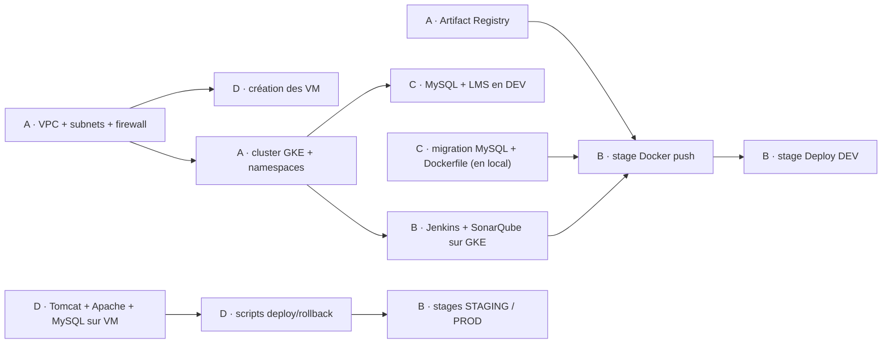

# Plan d'équipe — qui fait quoi

Chaque membre porte **un domaine de bout en bout** (J1 → J4) et le présente à la démo.
Les noms et valeurs partagés sont dans [`CONVENTIONS.md`](../CONVENTIONS.md).

## Vue d'ensemble

| Rôle | Responsable | Périmètre | Dossiers | Relu par |
|---|---|---|---|---|
| **A — Plateforme & réseau** | _à compléter_ | VPC, firewall, NAT, GKE, Artifact Registry, IaC, monitoring, sécurité GKE | `infra/`, `k8s/namespaces.yaml` | D |
| **B — CI : Jenkins & qualité** | _à compléter_ | Jenkins sur GKE, SonarQube, Jenkinsfile, webhook | `k8s/jenkins/`, `k8s/sonarqube/`, `Jenkinsfile` | C |
| **C — Application & conteneur** | _à compléter_ | Migration MySQL du code, Dockerfile, environnement DEV, tests | `src/`, `pom.xml`, `Dockerfile`, `k8s/dev/` | B |
| **D — VM STAGING & PROD** | _à compléter_ | 2 VM Rocky 9 (Tomcat, Apache, MySQL), scripts deploy/rollback | `scripts/`, `infra/vm-*.sh` | A |

Les binômes de relecture (A↔D, B↔C) travaillent sur des sujets proches : chacun comprend ce qu'il relit.

## Dépendances



**Ce qui démarre sans attendre personne :** C (migration MySQL et Dockerfile en local avec Docker Desktop) et B (écriture des manifests et du Jenkinsfile).
**Ce qui bloque tout le monde :** le réseau et le cluster de A. C'est la priorité absolue du J1 matin.

## Planning

| | A — Plateforme | B — CI | C — Application | D — VM |
|---|---|---|---|---|
| **J1** | Réseau, NAT, cluster, registry, script IaC | Manifests Jenkins + Sonar (local) | Migration MySQL, Dockerfile (local) | VM créées, Java/Tomcat/Apache/MySQL |
| **J2** | Aide B pour les droits GKE ↔ registry | Jenkins + Sonar déployés, pipeline jusqu'au DEV | MySQL + LMS en DEV sur GKE | WAR déployé à la main sur STAGING, HTTPS |
| **J3** | Monitoring, uptime checks, alertes | Stages STAGING/PROD, Quality Gate | Corriger 3 issues Sonar, tests | Scripts deploy/rollback, test de rollback |
| **J4** | NetworkPolicy, RBAC, Trivy, coûts | Durcissement Jenkins, secrets | Secrets K8s, image minimale | Durcissement Tomcat/MySQL/SSH |

---

## A — Plateforme & réseau

**Mission :** fournir à l'équipe un réseau et un cluster prêts à l'emploi, reproductibles par script.

**Responsabilités**
- Tout ce qui est réseau GCP : VPC, sous-réseaux, firewall, Cloud Router/NAT
- Le cluster GKE et ses namespaces
- Le dépôt Artifact Registry et l'accès du cluster à ce dépôt
- Le script IaC qui recrée l'infrastructure de zéro
- Le monitoring et les alertes
- **Les coûts** : extinction du cluster et des VM quand personne ne travaille

**Tâches**
- [ ] J1 — Créer le VPC `lms-vpc` et les 3 sous-réseaux (avec les plages secondaires pods/services)
- [ ] J1 — Créer les règles firewall (SSH via IAP seulement, web, interne)
- [ ] J1 — Créer Cloud Router + Cloud NAT
- [ ] J1 — Créer le cluster `lms-cluster` et les namespaces `cicd`, `quality`, `dev`
- [ ] J1 — Créer le dépôt `lms-docker` dans Artifact Registry
- [ ] J1 — Écrire `infra/network.sh`, `infra/gke-cluster.sh`, `infra/registry.sh` et `infra/destroy.sh`
- [ ] J3 — Uptime checks sur STAGING et PROD, alertes mail (health check KO, CPU > 80 %)
- [ ] J4 — NetworkPolicy entre namespaces, RBAC, scan Trivy des images
- [ ] J4 — Estimation des coûts réels pour le rapport

**Comment, en bref**
```bash
gcloud compute networks create lms-vpc --subnet-mode=custom
gcloud compute networks subnets create subnet-gke --network=lms-vpc --region=europe-west1 \
  --range=10.0.0.0/20 --secondary-range=pods=10.4.0.0/14,services=10.8.0.0/20
gcloud container clusters create lms-cluster --zone=europe-west1-b --num-nodes=2 \
  --machine-type=e2-standard-2 --network=lms-vpc --subnetwork=subnet-gke \
  --cluster-secondary-range-name=pods --services-secondary-range-name=services --enable-ip-alias
gcloud container clusters resize lms-cluster --num-nodes=0 --zone=europe-west1-b   # le soir
```

**Terminé quand :** `kubectl get ns` affiche les 3 namespaces, chaque membre a fait `get-credentials`, et `infra/destroy.sh` puis les scripts de création recréent tout sans erreur.

---

## B — CI : Jenkins & qualité

**Mission :** un `git push` sur `develop` déclenche tout le pipeline sans intervention.

**Responsabilités**
- Jenkins dans le namespace `cicd` (PVC, plugins, credentials)
- SonarQube dans le namespace `quality` et la Quality Gate
- Le `Jenkinsfile` complet : du checkout au déploiement PROD
- Le webhook GitHub → Jenkins
- La gestion des credentials dans Jenkins (aucun secret dans le repo)

**Tâches**
- [ ] J1 — Écrire les manifests Jenkins (PVC 10 Go, Deployment, Service) et SonarQube (PVC 5 Go, Deployment, Service)
- [ ] J2 — Déployer Jenkins et SonarQube, installer les plugins (Pipeline, Kubernetes, Docker Pipeline, SonarQube Scanner, SSH Agent)
- [ ] J2 — Créer les credentials (`sonar-token`, `github-token`) et le projet `lms-platform` dans SonarQube
- [ ] J2 — Jenkinsfile : Checkout → Compile → Test → SonarQube → Package → Docker → Deploy DEV
- [ ] J2 — Webhook GitHub (ou polling si Jenkins n'est pas joignable depuis Internet)
- [ ] J3 — Stages Deploy STAGING (auto sur `develop`), Smoke tests, Deploy PROD (`input`, sur `main`)
- [ ] J3 — Quality Gate : bloquant sur bugs et vulnérabilités critiques
- [ ] J4 — Durcissement : compte admin Jenkins, droits minimaux, nettoyage des builds

**Comment, en bref**
```bash
kubectl apply -f k8s/jenkins/
kubectl -n cicd port-forward svc/jenkins 8080:8080
kubectl -n cicd exec deploy/jenkins -- cat /var/jenkins_home/secrets/initialAdminPassword
```
- Build Docker dans GKE : conteneur `docker:dind` **privilégié** dans le pod agent (pas de `docker.sock` sur GKE), ou Cloud Build.
- Tag de l'image = `${BUILD_NUMBER}`.

**Terminé quand :** un commit sur `develop` met à jour le pod DEV puis STAGING sans action manuelle, et un merge sur `main` s'arrête sur la demande de validation PROD.

---

## C — Application & conteneur

**Mission :** l'application tourne sur MySQL, dans une image Docker, en DEV sur GKE.

**Responsabilités**
- La migration du code H2 → MySQL (environ 25 lignes dans 7 fichiers)
- Le `Dockerfile` multi-stage (Maven → Tomcat 11 / Java 21)
- L'environnement DEV : MySQL, LMS, Secret, Service, Ingress
- Les tests unitaires minimum pour la couverture SonarQube
- La correction des issues SonarQube

**Tâches**
- [ ] J1 — Branche `feature/app-mysql-support` : driver MySQL dans `pom.xml`, driver choisi selon l'URL, `CLOB` → `LONGTEXT`, `` `groups` `` entre backticks, `MERGE` → `INSERT … ON DUPLICATE KEY UPDATE`, `DATEADD` remplacé, `BackupService` adapté
- [ ] J1 — Tester en local : MySQL en conteneur + l'appli, cliquer sur chaque écran
- [ ] J1 — Écrire le `Dockerfile` multi-stage et vérifier `docker build` en local
- [ ] J2 — Manifests `k8s/dev/` : MySQL (PVC 5 Go, Secret `mysql-creds`), LMS (`lms-app`), Service, Ingress
- [ ] J2 — Passer la config en `-D` via `JAVA_OPTS` (l'appli ne lit pas les variables d'environnement)
- [ ] J3 — Corriger au moins 3 issues SonarQube sur `feature/app-sonar-fixes`
- [ ] J3 — Ajouter quelques tests unitaires (`PasswordUtil`, `JsonHelper`)
- [ ] J4 — Image plus légère et sans outils inutiles, vérifier le scan Trivy

**Comment, en bref**
```bash
docker run -d --name mysql-local -e MYSQL_ROOT_PASSWORD=root -e MYSQL_DATABASE=lms_platform \
  -e MYSQL_USER=lms -e MYSQL_PASSWORD=lms -p 3306:3306 mysql:8.0
mvn clean package
docker build -t lms-platform:local .
kubectl -n dev create secret generic mysql-creds --from-literal=user=lms --from-literal=password=...
kubectl -n dev rollout status deployment/lms-app
```

**Terminé quand :** l'appli fonctionne en DEV sur MySQL (connexion admin, création d'un utilisateur, upload d'un cours), et `kubectl -n dev rollout undo deployment/lms-app` revient à la version précédente.

---

## D — VM STAGING & PROD

**Mission :** deux serveurs classiques prêts à recevoir le WAR, avec retour arrière en une commande.

**Responsabilités**
- Les VM `lms-staging` et `lms-prod` et leur installation complète
- Apache en reverse proxy HTTPS devant Tomcat
- MySQL local sur chaque VM, accessible seulement en local
- L'utilisateur `deploy` et les clés SSH de Jenkins
- Les scripts `deploy-staging.sh`, `deploy-prod.sh`, `rollback.sh`
- L'ops-agent (logs vers Cloud Logging)

**Tâches**
- [ ] J1 — Créer les 2 VM (Rocky Linux 9, `e2-medium`, tag `app-server`) dans leurs sous-réseaux
- [ ] J1 — Installer Java 21, Tomcat 11 (archive Apache + service systemd), MySQL 8, Apache httpd
- [ ] J1 — Créer la base `lms_platform` et l'utilisateur `lms`, MySQL en écoute sur `127.0.0.1`
- [ ] J2 — Apache : VirtualHost 80 → redirection 301, VirtualHost 443 → proxy vers Tomcat, en-têtes de sécurité
- [ ] J2 — Déployer le WAR à la main sur STAGING et valider l'appli
- [ ] J2 — Utilisateur `deploy` + clé publique Jenkins dans `authorized_keys`, droits sur `webapps/`
- [ ] J3 — Écrire `scripts/deploy-staging.sh`, `deploy-prod.sh`, `rollback.sh` (corriger le bug du heredoc de l'énoncé)
- [ ] J3 — Tester un rollback complet (déployer un WAR cassé, restaurer)
- [ ] J4 — Durcissement : webapps Tomcat par défaut supprimées, MySQL sans accès distant, SSH par clé uniquement

**Comment, en bref**
```bash
gcloud compute instances create lms-staging --zone=europe-west1-b --machine-type=e2-medium \
  --subnet=subnet-staging --image-family=rocky-linux-9 --image-project=rocky-linux-cloud \
  --tags=app-server --labels=equipe=lms
gcloud compute ssh lms-staging --zone=europe-west1-b --tunnel-through-iap
sudo dnf install -y java-21-openjdk httpd mod_ssl mysql-server
sudo systemctl enable --now mysqld httpd
```
- Dans les scripts : `ssh deploy@hôte "bash -s" < script` ou un heredoc **non quoté**, sinon les variables locales n'arrivent pas sur la VM.

**Terminé quand :** `https://<IP-staging>/lms/` répond, `scripts/deploy-staging.sh` déploie un WAR et passe le health check, et `scripts/rollback.sh` restaure la version précédente.

---

## Tâches communes

- [ ] J1 — Chacun : accès au projet `formation-equipe`, `gcloud` configuré en `europe-west1`
- [ ] J1 — Chacun : `kubectl get pods -A` fonctionne
- [ ] J4 — Chacun : sa partie du rapport (architecture de sa brique, choix, difficultés et solutions)
- [ ] J4 — Ensemble : répétition de la démo complète, de `git push` jusqu'au rollback
- [ ] Fin — `infra/destroy.sh` : tout supprimer pour arrêter la facturation

## Fonctionnement

- **Une tâche = une Issue GitHub**, assignée à son responsable, dans le tableau du projet (À faire / En cours / Fait).
- **Point de 10 minutes par jour** : ce que j'ai fini, ce que je fais, ce qui me bloque.
- **Une Pull Request par sujet**, petite, relue par le binôme avant le merge dans `develop`.
- **Un blocage de plus de 30 minutes** se signale au groupe : c'est souvent une dépendance vers un autre rôle.
