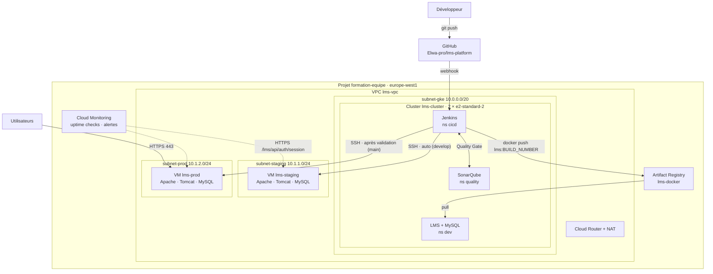

# Architecture

> Tenu par **A**. Schéma de référence pour le rapport et la démo. Exporter une version draw.io dans `rapport/captures/architecture.png` en fin de projet.

## Vue d'ensemble

## Flux réseau

| Source | Destination | Port | Règle firewall | Usage |
|---|---|---|---|---|
| Internet | VM (tag `app-server`) | 80, 443 | `lms-allow-web` | Accès au site |
| Plage IAP `35.235.240.0/20` | Toutes les VM | 22 | `lms-allow-ssh-iap` | Administration (`gcloud compute ssh --tunnel-through-iap`) |
| Pods GKE (`10.4.0.0/14`) | VM staging / prod | 22 | `lms-allow-internal` | Déploiement Jenkins par SSH |
| Nodes GKE | Internet | 443 | (sortie via NAT) | Téléchargement des images |
| Tomcat | MySQL | 3306 | — (local à la VM) | Base de données |

## À compléter

- [ ] IP internes réelles des VM
- [ ] Exposition de Jenkins (Ingress ou non) selon le choix de B
- [ ] Export draw.io pour le rapport
